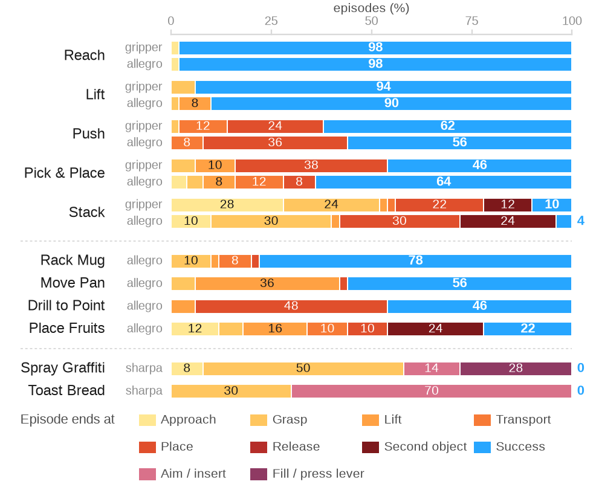

# Benchmark

<p class="ds-lede">Eleven tasks in two tracks, sixteen task-embodiment pairs, six imitation learning baselines, and one
evaluation protocol to compare them.</p>

## Tracks

Track 1, cross-embodiment
: Five tasks run with both the parallel-jaw gripper and the Allegro hand, with identical task definitions and success
  checks: [Reach](../tasks/reach.md) (Robotiq 2F-85), [Lift](../tasks/lift.md), [Push](../tasks/push.md),
  [Pick & Place](../tasks/pick_place.md) and [Stack](../tasks/stack.md) (UMI gripper). Ten pairs.

Track 2, dexterous capability
: Six hand-only tasks for stable grasping, constrained transport, tool use, several objects and long horizons:
  [Rack Mug](../tasks/pick_place_mug.md), [Move Pan](../tasks/pick_place_pan.md),
  [Drill to Point](../tasks/drill_to_point.md) and [Place Fruits](../tasks/pick_place_fruit.md) with the Allegro hand,
  [Spray Graffiti](../tasks/spray_graffiti.md) and [Toast Bread](../tasks/put_bread_toaster.md) with the Sharpa hand.
  Six pairs.

The two tracks separate the effect of the embodiment from the skills that need a hand.

## Protocol

```{raw} html
:file: ../_static/diagrams/protocol.svg
```

1. Train on the pair's demonstrations: the 50 human demonstrations, or the 200 scripted ones for Spray Graffiti and
   Toast Bread.
2. During training, roll the policy out for 50 episodes every 50 epochs and keep the checkpoint with the highest
   success. This is robomimic's procedure.
3. Evaluate that one checkpoint again on three new seeds with 50 episodes each, and report the mean success rate and
   the standard deviation.

The last step is the one that matters. The best of many noisy in-training rollouts is optimistic: for ACT, the
in-training maximum exceeds the same checkpoint's success on new seeds by 7 percentage points on average over its 14
pairs, and the last checkpoint was the best one in only 2 of them. With 50 episodes, the standard error of a success
rate can reach 7 points, while 150 evaluation episodes bring it to about 4, so gaps of a few points between policies
should be read with care. The spread across seeds is similar for both embodiments: 4.8 points for the gripper and 5.3
for the Allegro hand on average over the Track 1 tasks other than Stack.

Please use the same protocol when you report results on the benchmark.

## Results

Success rate (%), mean ± standard deviation over three evaluation seeds with 50 episodes each. Bold marks the best
result for each pair, once among state-based and once among image-based policies; results of 2% or less are not bolded.
BC-G, BC-GMM and BC-T are the robomimic implementations, with Diffusion Policy and ACT.

```{include} _partials/results.md
```

(where-policies-fail)=
## Where policies fail

Each task is split into the stages it must pass in order (see the task pages). Fifty diagnostic rollouts of the
state-based diffusion policy per pair show where episodes end:



- **Successive objects are the hard part.** On Stack, 22 to 30% of episodes fail at the first placement and 12 to 24%
  at the second object. On Place Fruits, 24% fail on the second fruit.
- **Precise tool use** is next: 48% of Drill to Point rollouts fail at the final alignment.
- **Spray Graffiti** fails at grasping the can in half the rollouts, and 28% paint without reaching the coverage.
- **Toast Bread** is not solved by any baseline.

## Running the baselines

[Training](training.md) shows how to convert a dataset, train a baseline and evaluate it with this protocol.
