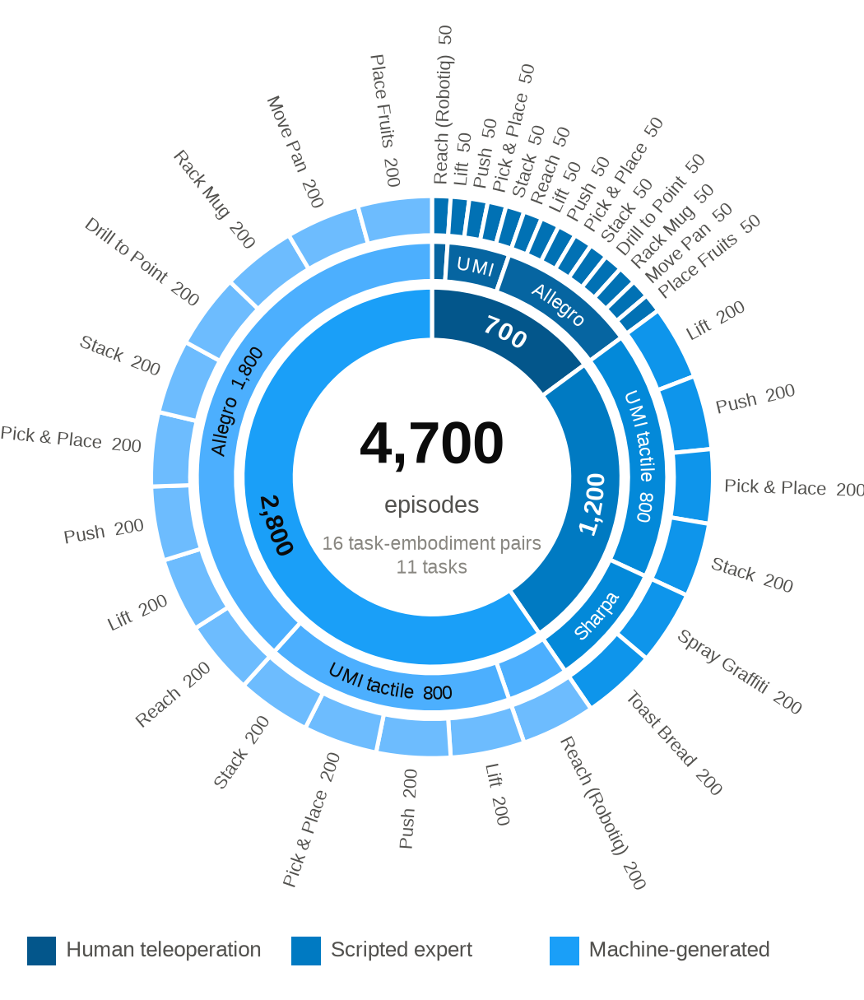

# Datasets

<p class="ds-lede">4,700 successful episodes covering the sixteen task-embodiment pairs of the benchmark, in LeRobot
format on Hugging Face.</p>



## Three tiers

Human teleoperation
: 700 demonstrations with the Robotiq, UMI and Allegro embodiments, 50 per task-embodiment pair, recorded with a Vive
  tracker and a Manus glove ([Recording](../teleop/recording.md)).

Scripted experts
: 1,200 demonstrations from task-specific controllers on the UMI tactile gripper and the Sharpa hand, 200 per pair.
  The UMI sets include the tactile pad readings ([Scripted collection](scripted.md)).

Machine-generated
: 2,800 successful rollouts of trained policies, 200 per pair.

Every episode is recorded at 20 Hz with front and wrist cameras, the full robot state, the task state and the action.

## On Hugging Face

```{include} _partials/datasets.md
```

The [data viewer](https://dexsuiteorg.github.io/v2/data.html) plays episodes of every set side by side with the hand
trajectory and the gripper closure.

## Loading a dataset

```python
from lerobot.datasets.lerobot_dataset import LeRobotDataset

ds = LeRobotDataset("dexsuite/lift_franka_allegro")
frame = ds[0]
frame["obs.state.gripper.tcp_pos"], frame["action"], frame["obs.cameras.front.rgb"]
```

Feature names follow the observation dictionary, flattened with dots, as described in
[Recording](../teleop/recording.md#what-is-stored). `meta/action_layout.json` gives the slices of the action and
`meta/env_config.json` the robot, camera and simulator options, so an episode can be replayed on the same robot.

## For robomimic

Convert a dataset to robomimic's HDF5 layout:

```bash
python -m scripts.imitation_learning.robomimic.lerobot_to_hdf5 --repo dexsuite/lift_franka_allegro --out datasets/lift_allegro
```

[Training](training.md) covers the conversion options and training the baselines.

```{toctree}
:hidden:

benchmark
training
scripted
```
