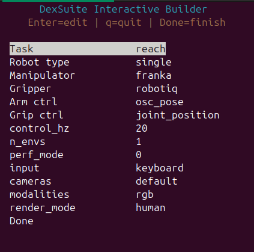
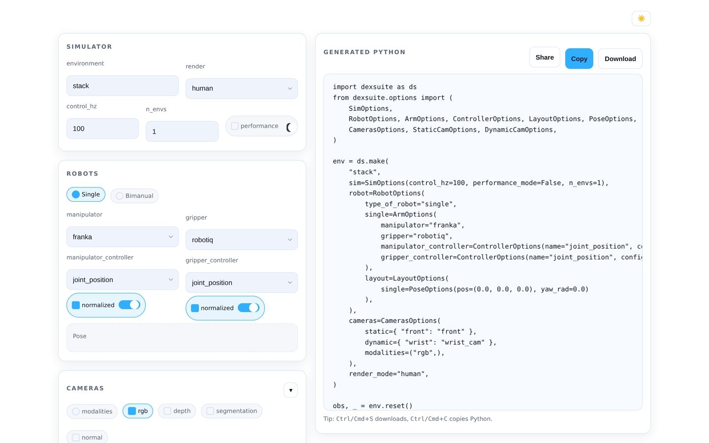

# Builders

<p class="ds-lede">Two helpers write the <code>ds.make</code> call for you: an interactive builder in the terminal that
can also run the result under teleoperation, and a single-page web builder.</p>

## Interactive builder

Run it from the repository root:

```bash
python -m scripts.interactive_builder
```



It walks through the task, the robot (one or two arms, end-effectors, controllers), the layout, the cameras and the
input device, saves the choices to `dexsuite_builder_spec.json`, then builds the environment and starts it.

| Option | Effect |
|---|---|
| `--ui tui` / `--ui simple` | full-screen menus or plain prompts |
| `--output FILE` | where to save the spec (default `dexsuite_builder_spec.json`) |
| `--no-run` | save the spec without starting the environment |
| `--input keyboard\|spacemouse\|vive_controller\|vive_tracker\|none` | device that drives the robot |

Run a saved spec again later:

```bash
python -m scripts.interactive_builder run --config dexsuite_builder_spec.json --input spacemouse
```

The spec holds the task, the robot type and arms, the layout preset, the control rate, `n_envs`, the cameras and
modalities, the render mode and the input device.

## Web builder

The web builder is a single HTML page that generates `ds.make` code as you click. Serve the folder and open the page:

```bash
python -m http.server --bind 127.0.0.1 -d scripts/web_builder 8000
# then open http://localhost:8000/env_builder.html
```



```{note}
The web builder lists the common arms, end-effectors and controllers. For the full set, use the interactive builder
or the [catalog](../robots/index.md).
```

## Writing it by hand

Both builders produce one of the two forms that `ds.make` accepts. The direct form names everything inline:

```python
env = ds.make("pick_place", manipulator="ur5", gripper="robotiq",
              arm_control="osc_pose", gripper_control="joint_position",
              cameras=["front", "wrist"], control_hz=20)
```

The options form passes option objects, which is what you want for two arms or custom cameras:

```python
robot = ds.RobotOptions(single=ds.ArmOptions(manipulator="ur5", gripper="robotiq"))
env = ds.make("pick_place", robot=robot, sim=ds.SimOptions(control_hz=20))
```

[Making environments](../concepts/make.md) has every argument.
