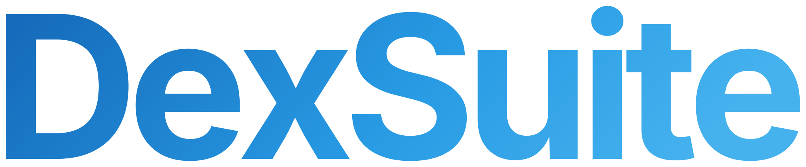
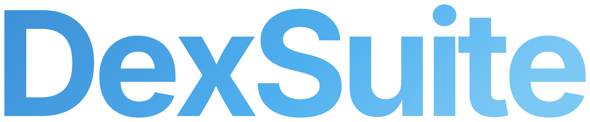
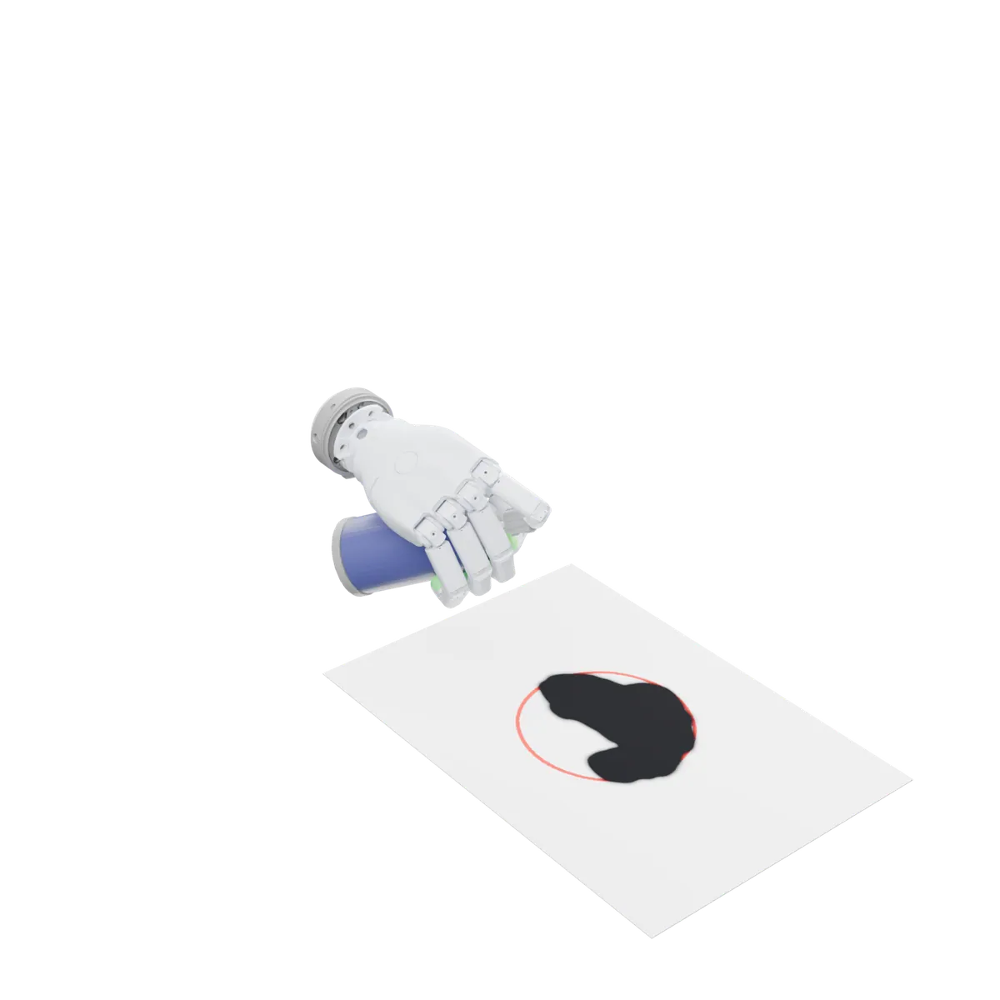

# DexSuite

<div class="ds-hero">
<div>


<p class="ds-tagline">Dexterous manipulation.<br><span>All in one framework.</span></p>
<p>DexSuite is a simulation framework for dexterous manipulation built on <a href="https://genesis-embodied-ai.github.io/">Genesis</a>.
It brings the robots, the tasks, teleoperation, tactile sensing, the data and the evaluation into one stack, and every
task runs with any arm and any end-effector that fits it.</p>
<div class="ds-btns">
<a class="ds-btn" href="get-started/installation.html">Install</a>
<a class="ds-btn ghost" href="get-started/quickstart.html">Quickstart</a>
<a class="ds-btn ghost" href="tasks/index.html">Browse tasks</a>
</div>
</div>

</div>

<div class="ds-stats">
<div class="ds-stat"><b>26</b><span>tasks ready to run</span></div>
<div class="ds-stat"><b>16</b><span>arms and robots</span></div>
<div class="ds-stat"><b>11</b><span>end-effectors</span></div>
<div class="ds-stat"><b>16</b><span>benchmark task-embodiment pairs</span></div>
<div class="ds-stat"><b>4,700</b><span>episodes on Hugging Face</span></div>
</div>

```python
import dexsuite as ds

env = ds.make("lift", manipulator="franka", gripper="allegro")
obs, info = env.reset(seed=0)
obs, reward, terminated, truncated, info = env.step(env.action_space.sample())
```

<p class="ds-section-label">Start here</p>

::::{grid} 1 2 3 3
:gutter: 3

:::{grid-item-card} Install
:link: get-started/installation
:link-type: doc
`pip install dexsuite`: Python, Genesis and a GPU, with every robot and task.
:::

:::{grid-item-card} Quickstart
:link: get-started/quickstart
:link-type: doc
Make an environment, step it, read observations and drive it from the keyboard.
:::

:::{grid-item-card} Concepts
:link: concepts/index
:link-type: doc
How `ds.make` composes a task, a robot, cameras and the simulator, and what comes back from `step`.
:::
::::

<p class="ds-section-label">Catalog</p>

::::{grid} 1 2 2 2
:gutter: 3

:::{grid-item-card} Tasks
:link: tasks/index
:link-type: doc
:img-top: _static/tasks/stack.webp
Reaching and stacking, mugs and pans, drills, spray cans, toasters, safes, and two-arm tasks.
:::

:::{grid-item-card} Robots
:link: robots/index
:link-type: doc
:img-top: _static/catalog/ee_allegro.webp
Ten arms, six integrated robots, a floating wrist and eleven end-effectors, from parallel-jaw grippers to a 24-joint hand.
:::
::::

<p class="ds-section-label">Collect, train, evaluate</p>

::::{grid} 1 2 3 3
:gutter: 3

:::{grid-item-card} Teleoperation
:link: teleop/index
:link-type: doc
Keyboard, SpaceMouse, Vive trackers and the Manus glove, recorded straight to LeRobot.
:::

:::{grid-item-card} Datasets
:link: data/index
:link-type: doc
4,700 successful episodes in LeRobot format, with an HDF5 export for robomimic.
:::

:::{grid-item-card} Benchmark
:link: data/benchmark
:link-type: doc
Sixteen task-embodiment pairs, the evaluation protocol and the baseline results.
:::
::::

```{toctree}
:hidden:
:maxdepth: 2

get-started/index
concepts/index
tasks/index
robots/index
teleop/index
data/index
how-to/index
reference/index
```
