# Arms

Ten modular arms, six integrated robots and a floating wrist. Every arm has a workspace box in
<code>dexsuite/config/workspaces.yaml</code> and starts each episode at a fixed home pose.

## Modular arms

(franka)=
### Franka Panda

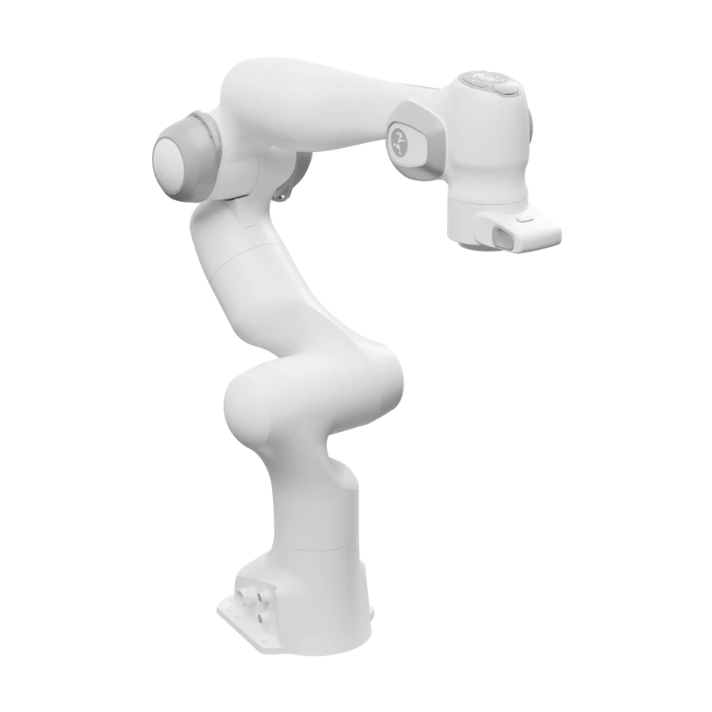

<dl class="ds-spec">
<dt>Key</dt><dd><code>franka</code></dd>
<dt>Maker</dt><dd>Franka Robotics</dd>
<dt>Degrees of freedom</dt><dd>7</dd>
<dt>Model</dt><dd><code>panda_nohand.xml</code>, license Apache-2.0 (MuJoCo Menagerie)</dd>
<dt>End-effectors</dt><dd>`robotiq`, `umi`, `barrett`, `dclaw`, `inspire`, `ability`, `schunk`, `allegro`, `leap`, `shadow`</dd>
</dl>

(franka_fr3)=
### Franka FR3

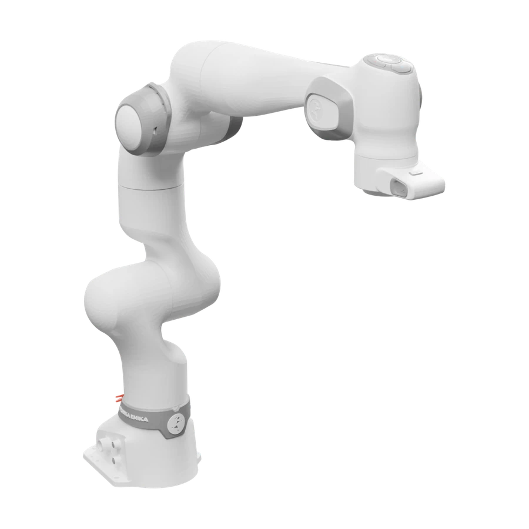

<dl class="ds-spec">
<dt>Key</dt><dd><code>franka_fr3</code></dd>
<dt>Maker</dt><dd>Franka Robotics</dd>
<dt>Degrees of freedom</dt><dd>7</dd>
<dt>Model</dt><dd><code>fr3.xml</code>, license Apache-2.0</dd>
<dt>End-effectors</dt><dd>`robotiq`, `umi`, `barrett`, `dclaw`, `inspire`, `ability`, `schunk`, `allegro`, `leap`, `shadow`</dd>
</dl>

(gen3)=
### Kinova Gen3

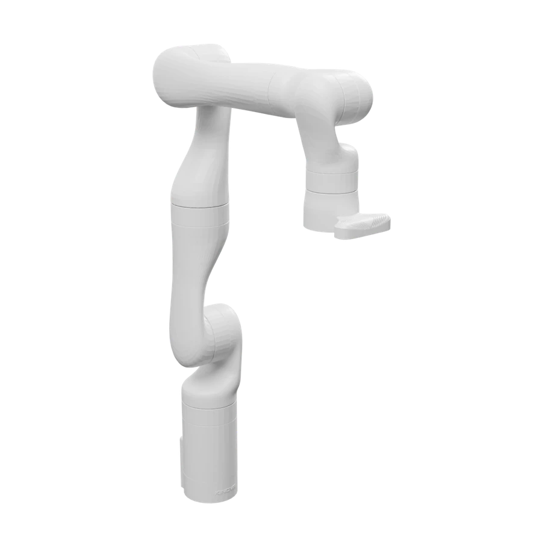

<dl class="ds-spec">
<dt>Key</dt><dd><code>gen3</code></dd>
<dt>Maker</dt><dd>Kinova</dd>
<dt>Degrees of freedom</dt><dd>7</dd>
<dt>Model</dt><dd><code>gen3.xml</code>, license BSD-3</dd>
<dt>End-effectors</dt><dd>`robotiq`, `umi`, `barrett`, `dclaw`, `inspire`, `ability`, `schunk`, `allegro`, `shadow`</dd>
</dl>

(kuka)=
### KUKA LBR iiwa 14

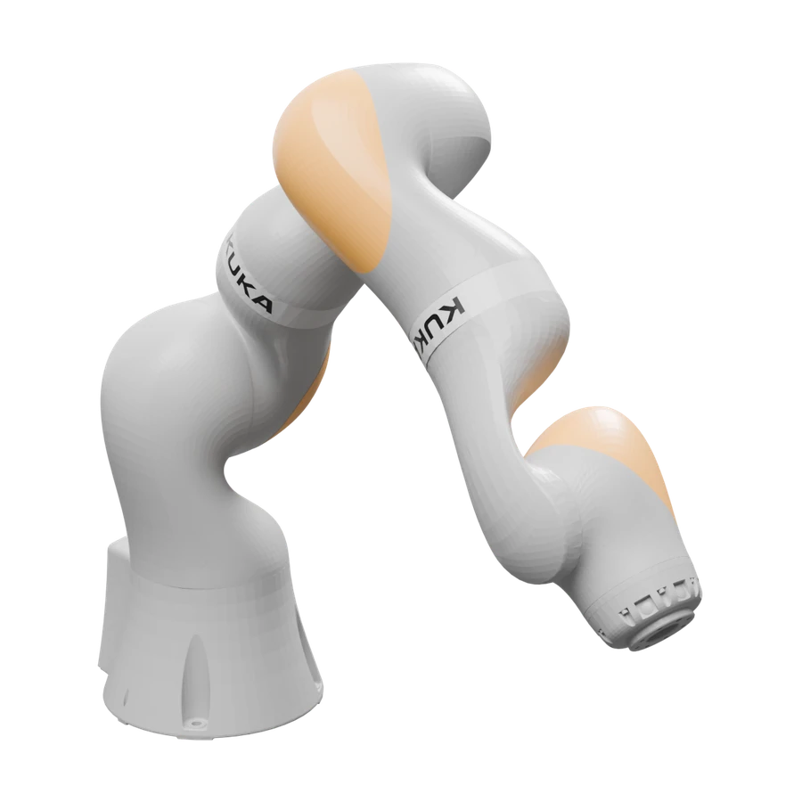

<dl class="ds-spec">
<dt>Key</dt><dd><code>kuka</code></dd>
<dt>Maker</dt><dd>KUKA</dd>
<dt>Degrees of freedom</dt><dd>7</dd>
<dt>Model</dt><dd><code>iiwa14.xml</code>, license BSD-3 (Drake)</dd>
<dt>End-effectors</dt><dd>`robotiq`, `umi`, `barrett`, `dclaw`, `inspire`, `ability`, `schunk`, `allegro`, `shadow`</dd>
</dl>

(sawyer)=
### Rethink Sawyer

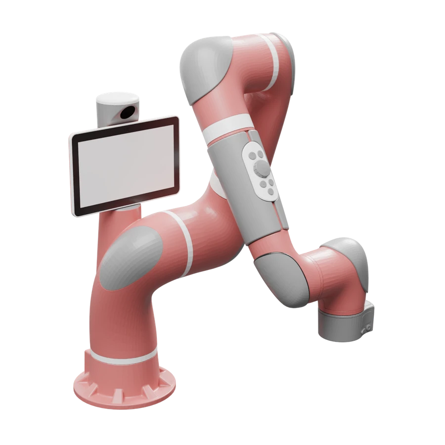

<dl class="ds-spec">
<dt>Key</dt><dd><code>sawyer</code></dd>
<dt>Maker</dt><dd>Rethink Robotics</dd>
<dt>Degrees of freedom</dt><dd>7</dd>
<dt>Model</dt><dd><code>sawyer.xml</code>, license not stated</dd>
<dt>End-effectors</dt><dd>`robotiq`, `umi`, `barrett`, `dclaw`, `inspire`, `ability`, `schunk`, `allegro`, `shadow`</dd>
</dl>

(ur5)=
### UR5e

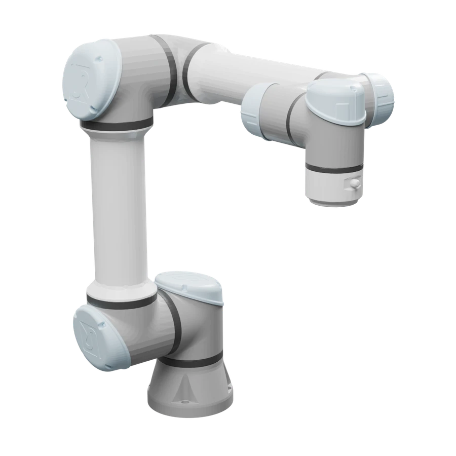

<dl class="ds-spec">
<dt>Key</dt><dd><code>ur5</code></dd>
<dt>Maker</dt><dd>Universal Robots</dd>
<dt>Degrees of freedom</dt><dd>6</dd>
<dt>Model</dt><dd><code>ur5e.xml</code>, license BSD-3</dd>
<dt>End-effectors</dt><dd>`robotiq`, `umi`, `barrett`, `dclaw`, `inspire`, `ability`, `schunk`, `allegro`, `leap`</dd>
</dl>

(ur10)=
### UR10e

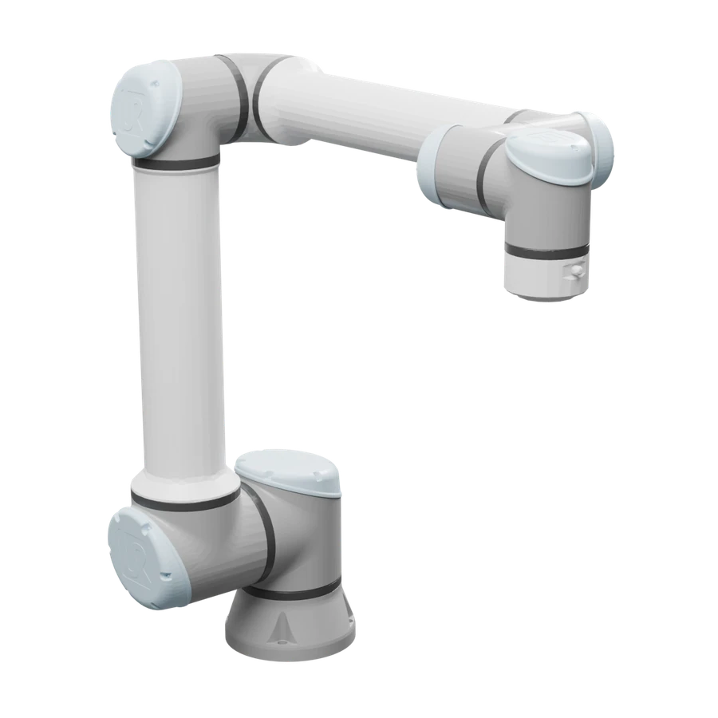

<dl class="ds-spec">
<dt>Key</dt><dd><code>ur10</code></dd>
<dt>Maker</dt><dd>Universal Robots</dd>
<dt>Degrees of freedom</dt><dd>6</dd>
<dt>Model</dt><dd><code>ur10e.xml</code>, license BSD-3</dd>
<dt>End-effectors</dt><dd>`robotiq`, `umi`, `barrett`, `dclaw`, `inspire`, `ability`, `schunk`, `allegro`, `shadow`</dd>
</dl>

(lite6)=
### UFactory Lite 6

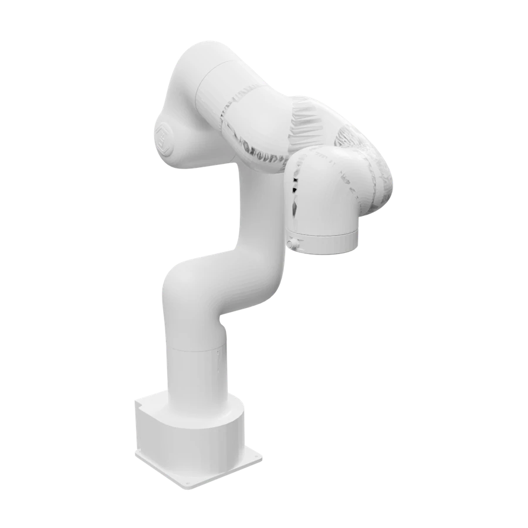

<dl class="ds-spec">
<dt>Key</dt><dd><code>lite6</code></dd>
<dt>Maker</dt><dd>UFactory</dd>
<dt>Degrees of freedom</dt><dd>6</dd>
<dt>Model</dt><dd><code>lite6.xml</code>, license BSD-style</dd>
<dt>End-effectors</dt><dd>`robotiq`, `umi`, `barrett`, `dclaw`, `inspire`, `ability`, `schunk`, `allegro`, `shadow`</dd>
</dl>

(link6)=
### Link6

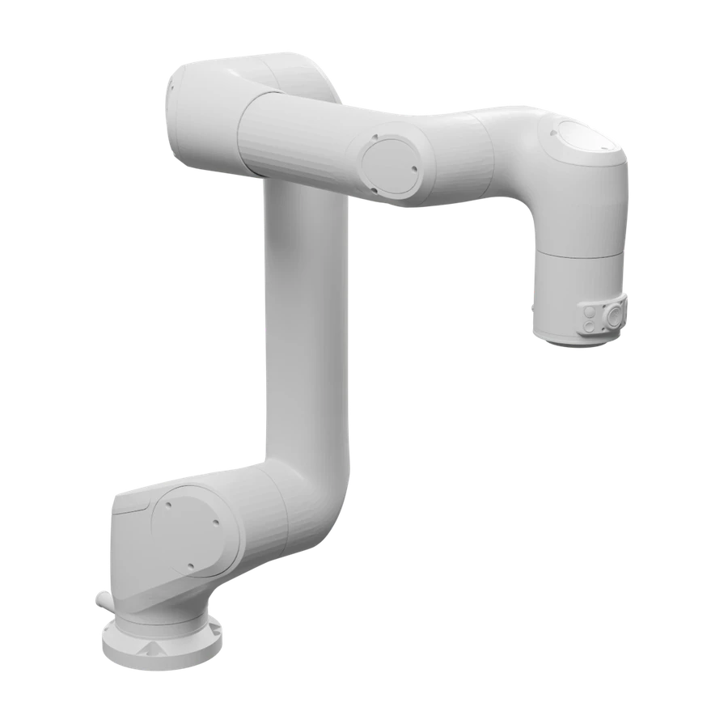

<dl class="ds-spec">
<dt>Key</dt><dd><code>link6</code></dd>
<dt>Maker</dt><dd>Kinova</dd>
<dt>Degrees of freedom</dt><dd>6</dd>
<dt>Model</dt><dd><code>link6_best.xml</code>, license BSD-3</dd>
<dt>End-effectors</dt><dd>`robotiq`, `umi`, `barrett`, `dclaw`, `inspire`, `ability`, `schunk`, `allegro`, `shadow`</dd>
</dl>

(z1)=
### Unitree Z1

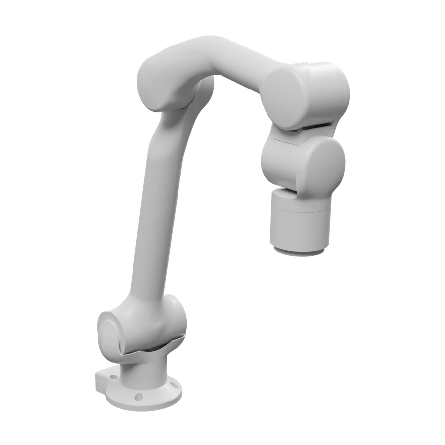

<dl class="ds-spec">
<dt>Key</dt><dd><code>z1</code></dd>
<dt>Maker</dt><dd>Unitree</dd>
<dt>Degrees of freedom</dt><dd>6</dd>
<dt>Model</dt><dd><code>z1.xml</code>, license not stated</dd>
<dt>End-effectors</dt><dd>`robotiq`, `umi`, `barrett`, `dclaw`, `inspire`, `ability`, `schunk`, `allegro`, `shadow`</dd>
</dl>

## Integrated robots

These come with their own gripper, so `gripper` is not passed. The gripper joints appear in `obs["state"]["gripper"]` like any other end-effector.

(franka_with_gripper)=
### Franka Panda with Franka Hand

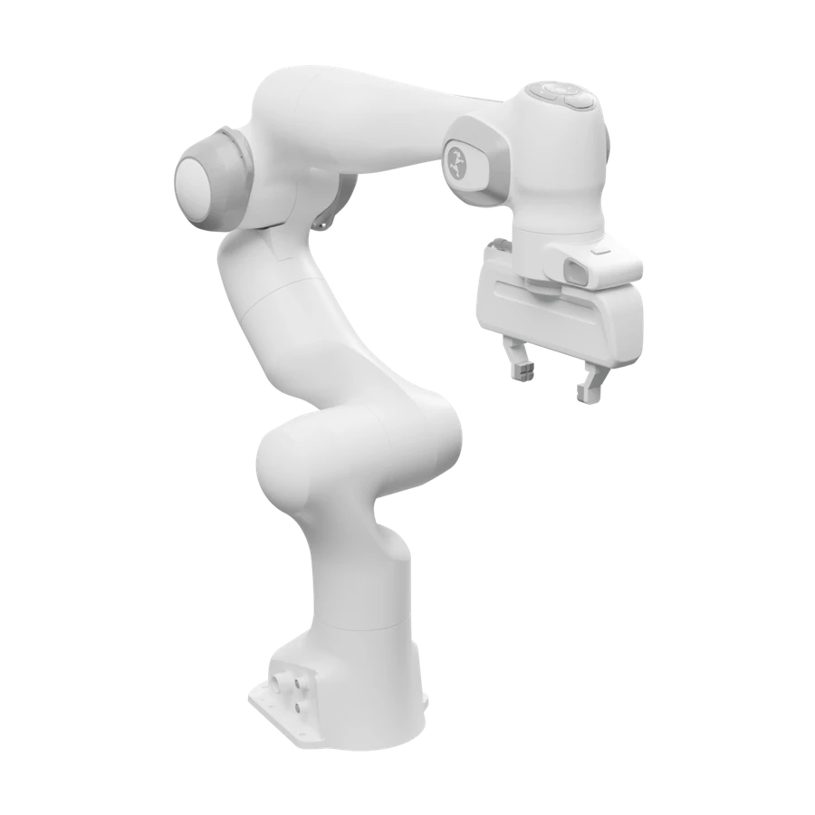

<dl class="ds-spec">
<dt>Key</dt><dd><code>franka_with_gripper</code></dd>
<dt>Degrees of freedom</dt><dd>7 + 2 (arm + gripper)</dd>
<dt>Gripper</dt><dd>two-finger Franka Hand</dd>
</dl>

(aloha_tactile)=
### ALOHA (tactile)

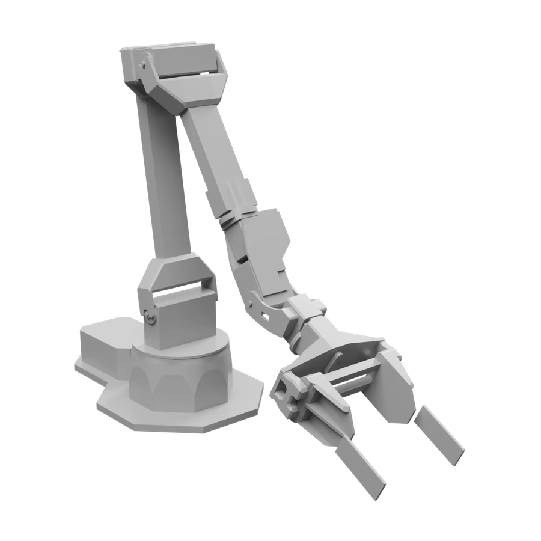

<dl class="ds-spec">
<dt>Key</dt><dd><code>aloha_tactile</code></dd>
<dt>Degrees of freedom</dt><dd>6 + 2 (arm + gripper)</dd>
<dt>Gripper</dt><dd>parallel jaw with tactile pads</dd>
<dt>Tactile</dt><dd>pads on both fingers, see <a href="../concepts/observations.html#tactile-pads">tactile</a></dd>
</dl>

(gen3_lite)=
### Kinova Gen3 Lite

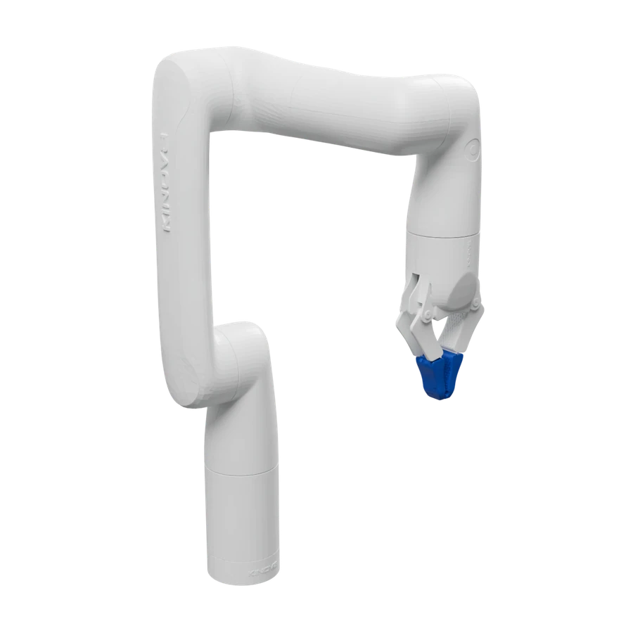

<dl class="ds-spec">
<dt>Key</dt><dd><code>gen3_lite</code></dd>
<dt>Degrees of freedom</dt><dd>6 + 1 (arm + gripper)</dd>
<dt>Gripper</dt><dd>two-finger gripper</dd>
</dl>

(so_100)=
### SO-100

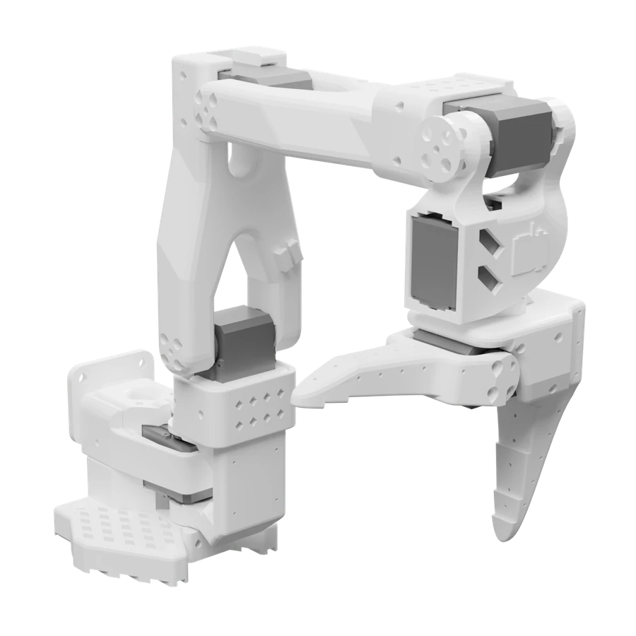

<dl class="ds-spec">
<dt>Key</dt><dd><code>so_100</code></dd>
<dt>Degrees of freedom</dt><dd>5 + 1 (arm + gripper)</dd>
<dt>Gripper</dt><dd>rotary jaw</dd>
</dl>

(trossen_vx300s)=
### Trossen ViperX 300 S

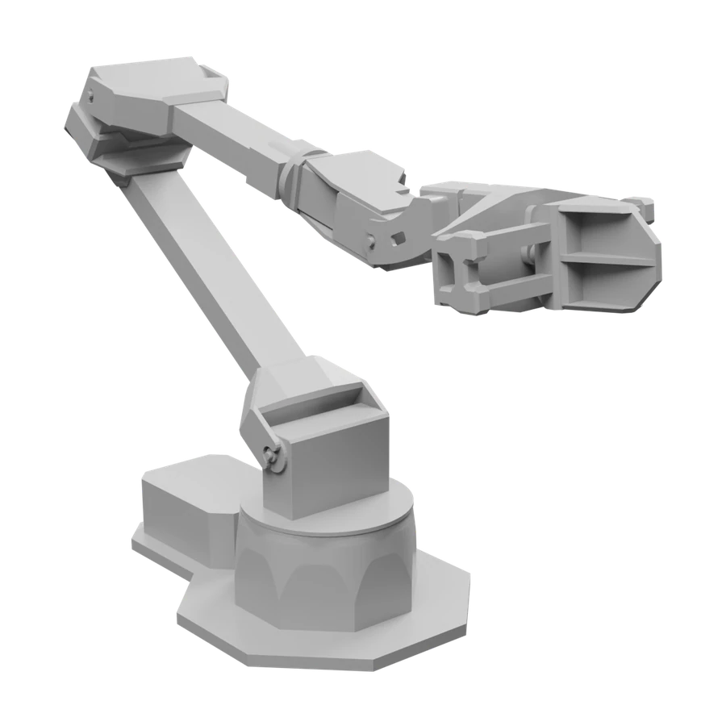

<dl class="ds-spec">
<dt>Key</dt><dd><code>trossen_vx300s</code></dd>
<dt>Degrees of freedom</dt><dd>6 + 1 (arm + gripper)</dd>
<dt>Gripper</dt><dd>parallel jaw</dd>
</dl>

(trossen_wx250s)=
### Trossen WidowX 250 S

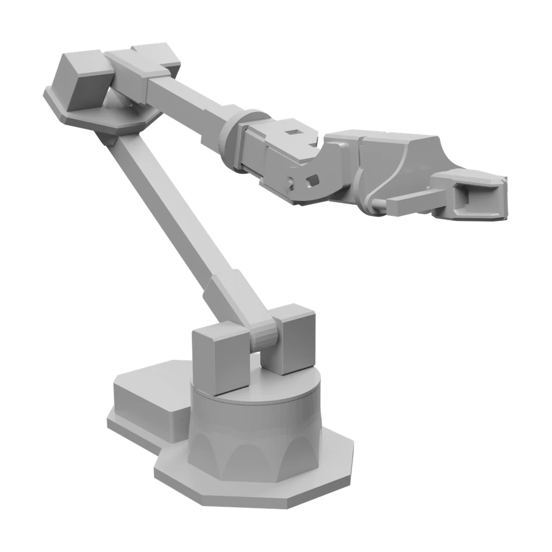

<dl class="ds-spec">
<dt>Key</dt><dd><code>trossen_wx250s</code></dd>
<dt>Degrees of freedom</dt><dd>6 + 1 (arm + gripper)</dd>
<dt>Gripper</dt><dd>parallel jaw</dd>
</dl>

## Floating wrist

(floating)=
### Floating wrist

A virtual 6-DoF gantry (x, y, z, roll, pitch, yaw) with no geometry, for hand-only tasks. It mounts the Sharpa and Allegro hands.

<dl class="ds-spec">
<dt>Key</dt><dd><code>floating</code></dd>
<dt>Degrees of freedom</dt><dd>6</dd>
<dt>End-effectors</dt><dd><code>sharpa</code>, <code>sharpa_right</code>, <code>allegro</code>, <code>allegro_right</code></dd>
</dl>
