# End-effectors

Eleven end-effectors, from parallel-jaw grippers to a 24-joint hand. Every one is controlled per
joint, so the gripper part of the action has one entry per actuated degree of freedom.

(robotiq)=
## Robotiq 2F-85

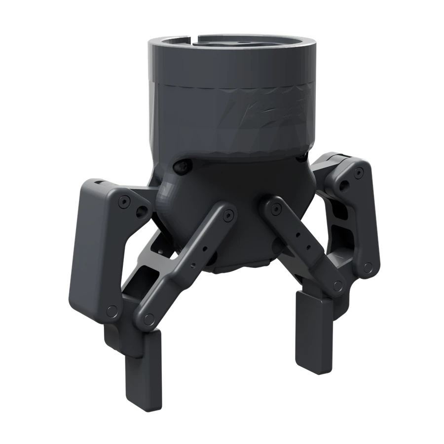

<dl class="ds-spec">
<dt>Key</dt><dd><code>robotiq</code></dd>
<dt>Type</dt><dd>Parallel-jaw gripper</dd>
<dt>Actuated DoF</dt><dd>1</dd>
<dt>Fingers</dt><dd>2</dd>
<dt>Mounts on</dt><dd><code>franka</code>, <code>franka_fr3</code>, <code>gen3</code>, <code>kuka</code>, <code>sawyer</code>, <code>ur5</code>, <code>ur10</code>, <code>lite6</code>, <code>link6</code>, <code>z1</code></dd>
<dt>Model license</dt><dd>BSD-2</dd>
</dl>

(franka_umi_tacticle)=
## UMI gripper

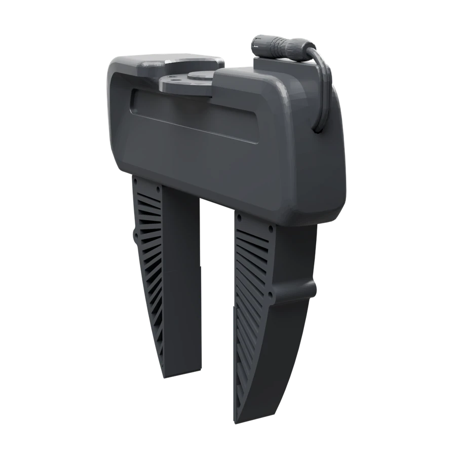

<dl class="ds-spec">
<dt>Key</dt><dd><code>franka_umi_tacticle</code></dd>
<dt>Type</dt><dd>Parallel-jaw gripper with tactile pads</dd>
<dt>Actuated DoF</dt><dd>2</dd>
<dt>Fingers</dt><dd>2</dd>
<dt>Tactile</dt><dd>pads on both fingers</dd>
<dt>Mounts on</dt><dd><code>franka</code>, <code>franka_fr3</code></dd>
<dt>Model license</dt><dd>not stated</dd>
</dl>

(barrett)=
## BarrettHand

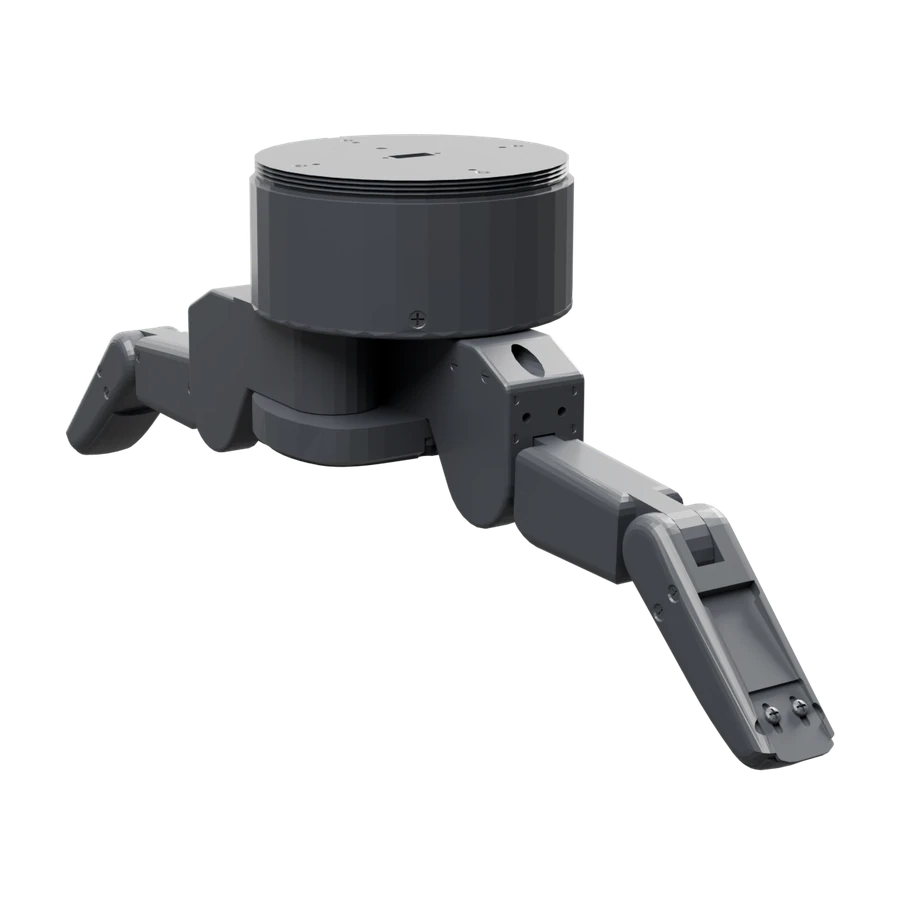

<dl class="ds-spec">
<dt>Key</dt><dd><code>barrett</code></dd>
<dt>Type</dt><dd>Three-finger hand</dd>
<dt>Actuated DoF</dt><dd>8</dd>
<dt>Fingers</dt><dd>3</dd>
<dt>Mounts on</dt><dd><code>franka</code>, <code>franka_fr3</code>, <code>gen3</code>, <code>kuka</code>, <code>sawyer</code>, <code>ur5</code>, <code>ur10</code>, <code>lite6</code>, <code>link6</code>, <code>z1</code></dd>
<dt>Model license</dt><dd>BSD-style</dd>
</dl>

(dclaw)=
## D'Claw

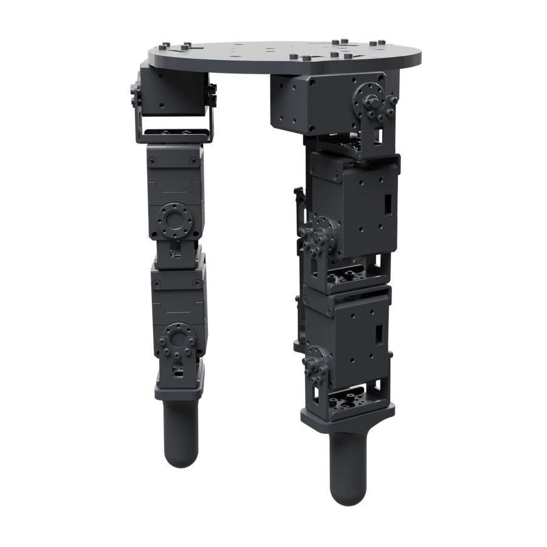

<dl class="ds-spec">
<dt>Key</dt><dd><code>dclaw</code></dd>
<dt>Type</dt><dd>Three-finger hand</dd>
<dt>Actuated DoF</dt><dd>9</dd>
<dt>Fingers</dt><dd>3</dd>
<dt>Mounts on</dt><dd><code>franka</code>, <code>franka_fr3</code>, <code>gen3</code>, <code>kuka</code>, <code>sawyer</code>, <code>ur5</code>, <code>ur10</code>, <code>lite6</code>, <code>link6</code>, <code>z1</code></dd>
<dt>Model license</dt><dd>Apache-2.0 (ROBEL)</dd>
</dl>

(inspire)=
## Inspire Hand

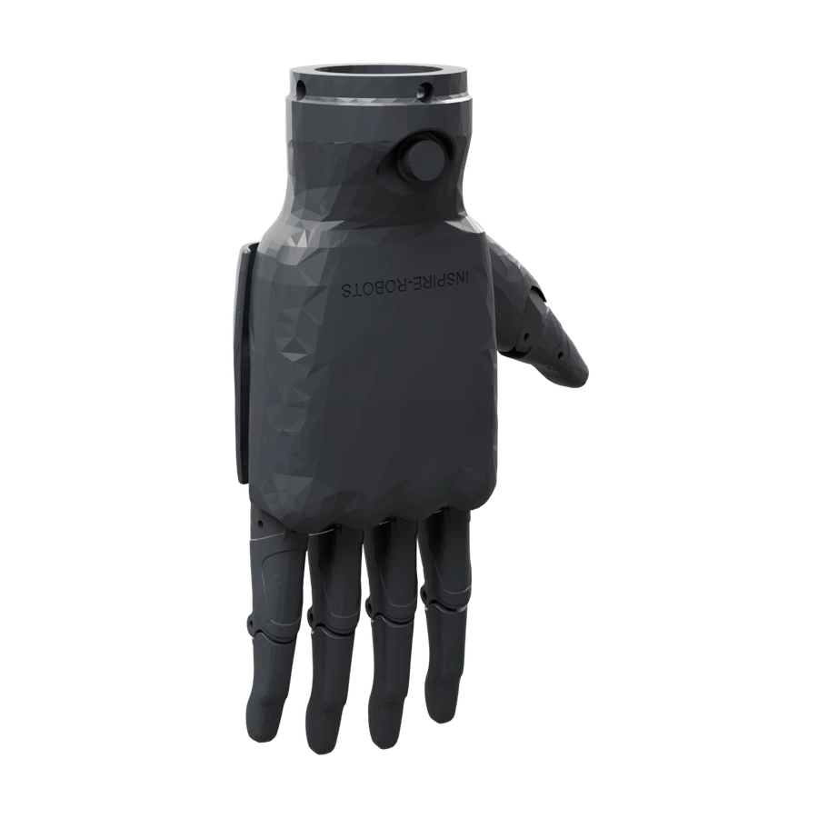

<dl class="ds-spec">
<dt>Key</dt><dd><code>inspire</code></dd>
<dt>Type</dt><dd>Five-finger hand</dd>
<dt>Actuated DoF</dt><dd>6</dd>
<dt>Fingers</dt><dd>5</dd>
<dt>Mounts on</dt><dd><code>franka</code>, <code>franka_fr3</code>, <code>gen3</code>, <code>kuka</code>, <code>sawyer</code>, <code>ur5</code>, <code>ur10</code>, <code>lite6</code>, <code>link6</code>, <code>z1</code></dd>
<dt>Model license</dt><dd>not stated (dex_urdf)</dd>
</dl>

(ability)=
## Ability Hand

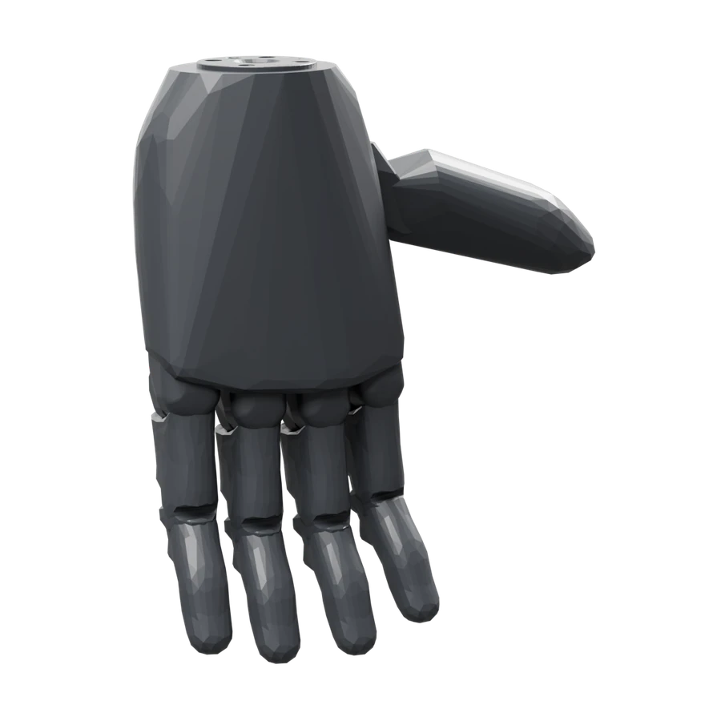

<dl class="ds-spec">
<dt>Key</dt><dd><code>ability</code></dd>
<dt>Type</dt><dd>Five-finger hand</dd>
<dt>Actuated DoF</dt><dd>6</dd>
<dt>Fingers</dt><dd>5</dd>
<dt>Mounts on</dt><dd><code>franka</code>, <code>franka_fr3</code>, <code>gen3</code>, <code>kuka</code>, <code>sawyer</code>, <code>ur5</code>, <code>ur10</code>, <code>lite6</code>, <code>link6</code>, <code>z1</code></dd>
<dt>Model license</dt><dd>not stated (dex_urdf)</dd>
</dl>

(schunk)=
## Schunk SVH

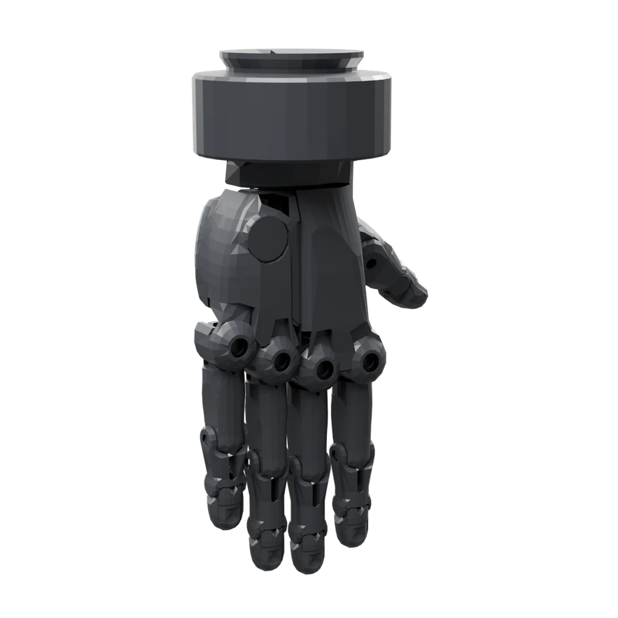

<dl class="ds-spec">
<dt>Key</dt><dd><code>schunk</code></dd>
<dt>Type</dt><dd>Five-finger hand</dd>
<dt>Actuated DoF</dt><dd>9</dd>
<dt>Fingers</dt><dd>5</dd>
<dt>Mounts on</dt><dd><code>franka</code>, <code>franka_fr3</code>, <code>gen3</code>, <code>kuka</code>, <code>sawyer</code>, <code>ur5</code>, <code>ur10</code>, <code>lite6</code>, <code>link6</code>, <code>z1</code></dd>
<dt>Model license</dt><dd>GPL-3.0</dd>
</dl>

(allegro)=
## Allegro Hand

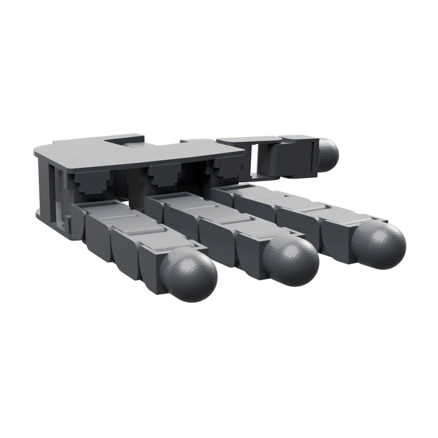

<dl class="ds-spec">
<dt>Key</dt><dd><code>allegro</code></dd>
<dt>Type</dt><dd>Four-finger hand</dd>
<dt>Actuated DoF</dt><dd>16</dd>
<dt>Fingers</dt><dd>4</dd>
<dt>Variants</dt><dd><code>allegro_left</code>, <code>allegro_right</code></dd>
<dt>Mounts on</dt><dd><code>franka</code>, <code>franka_fr3</code>, <code>gen3</code>, <code>kuka</code>, <code>sawyer</code>, <code>ur5</code>, <code>ur10</code>, <code>lite6</code>, <code>link6</code>, <code>z1</code>, <code>floating</code></dd>
<dt>Model license</dt><dd>BSD-2</dd>
</dl>

(leap)=
## LEAP Hand

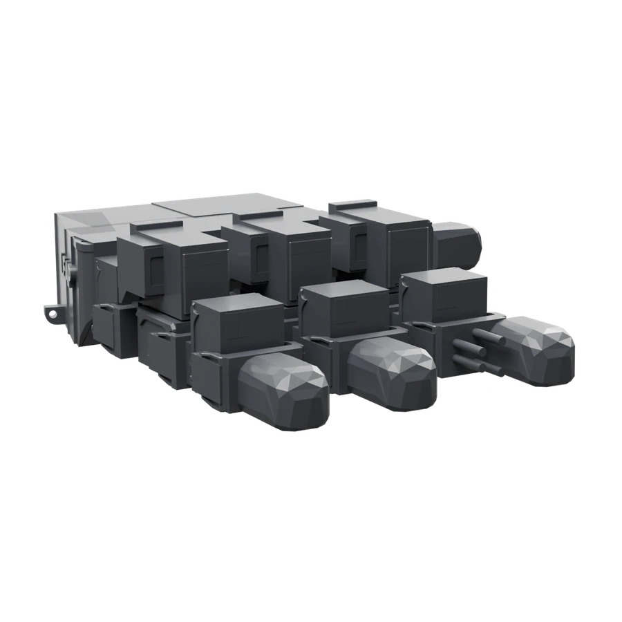

<dl class="ds-spec">
<dt>Key</dt><dd><code>leap</code></dd>
<dt>Type</dt><dd>Four-finger hand</dd>
<dt>Actuated DoF</dt><dd>16</dd>
<dt>Fingers</dt><dd>4</dd>
<dt>Variants</dt><dd><code>leap_left</code>, <code>leap_right</code></dd>
<dt>Mounts on</dt><dd><code>franka</code>, <code>franka_fr3</code>, <code>ur5</code></dd>
<dt>Model license</dt><dd>MIT</dd>
</dl>

(sharpa)=
## Sharpa Wave

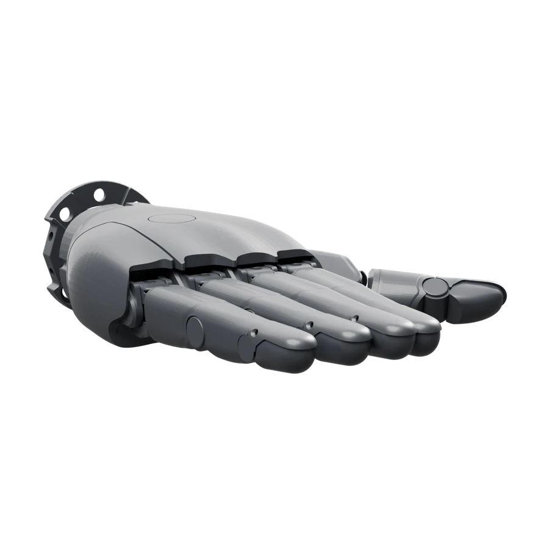

<dl class="ds-spec">
<dt>Key</dt><dd><code>sharpa</code></dd>
<dt>Type</dt><dd>Five-finger hand</dd>
<dt>Actuated DoF</dt><dd>22</dd>
<dt>Fingers</dt><dd>5</dd>
<dt>Variants</dt><dd><code>sharpa_left</code>, <code>sharpa_right</code></dd>
<dt>Mounts on</dt><dd><code>floating</code></dd>
<dt>Model license</dt><dd>not stated</dd>
</dl>

(shadow)=
## Shadow Hand

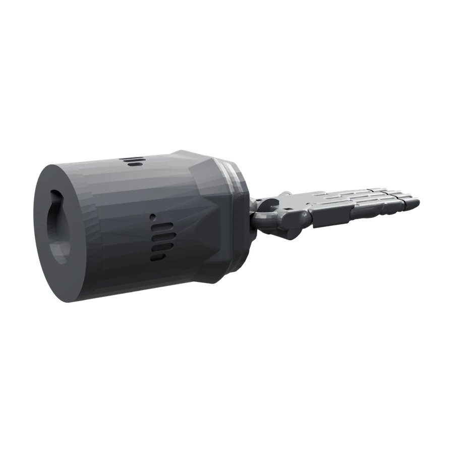

<dl class="ds-spec">
<dt>Key</dt><dd><code>shadow</code></dd>
<dt>Type</dt><dd>Five-finger hand</dd>
<dt>Actuated DoF</dt><dd>24</dd>
<dt>Fingers</dt><dd>5</dd>
<dt>Variants</dt><dd><code>shadow_left</code>, <code>shadow_right</code></dd>
<dt>Mounts on</dt><dd><code>franka</code>, <code>franka_fr3</code>, <code>gen3</code>, <code>kuka</code>, <code>sawyer</code>, <code>ur10</code>, <code>lite6</code>, <code>link6</code>, <code>z1</code></dd>
<dt>Model license</dt><dd>Apache-2.0</dd>
</dl>
