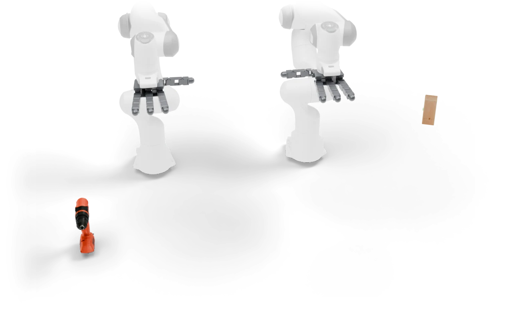

---
myst:
  html_meta:
    description: "Bimanual Drill to Point: Bring a power drill&#x27;s tip to a target marker on a wooden wall with two arms."
---

# Bimanual Drill to Point

<span class="ds-chip blue">bimanual</span><span class="ds-chip">rigid</span>

<p class="ds-lede">Bring a power drill&#x27;s tip to a target marker on a wooden wall with two arms.</p>



## At a glance

<dl class="ds-spec">
<dt>Task key</dt><dd><code>bimanual_drill_to_point</code></dd>
<dt>Horizon</dt><dd>30,000 control steps (1500 s at 20 Hz)</dd>
<dt>Objects</dt><dd>power drill, wall with a target</dd>
<dt>Success</dt><dd>No success check yet: the episode runs to the horizon.</dd>
<dt>Failure</dt><dd>None.</dd>
<dt>Shown with</dt><dd>two Franka arms with left and right Allegro hands</dd>
<dt>Action size</dt><dd>44 with the robot shown</dd>
<dt>Source</dt><dd><code>dexsuite/environments/bimanual/rigid/bimanual_drill_to_point.py</code></dd>
</dl>

## Order of interactions

1. Grasp the drill
2. Bring the tip to the target

These are the stages the [failure analysis](../data/benchmark.md#where-policies-fail) scores, in order.


## Run it

```python
import dexsuite as ds

env = ds.make(
    "bimanual_drill_to_point",
    manipulator=("franka", "franka"),
    gripper=("allegro_left", "allegro_right"),
)
obs, info = env.reset(seed=0)
obs, reward, terminated, truncated, info = env.step(env.action_space.sample())
```
