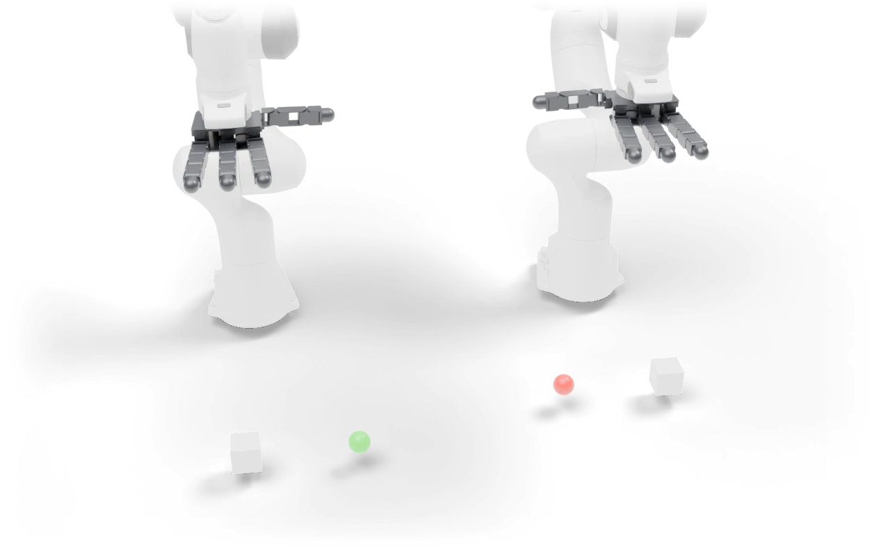

---
myst:
  html_meta:
    description: "Bimanual Push: Each arm pushes its cube to its goal."
---

# Bimanual Push

<span class="ds-chip blue">bimanual</span><span class="ds-chip">rigid</span>

<p class="ds-lede">Each arm pushes its cube to its goal.</p>



## At a glance

<dl class="ds-spec">
<dt>Task key</dt><dd><code>bimanual_push</code></dd>
<dt>Horizon</dt><dd>200 control steps (10 s at 20 Hz)</dd>
<dt>Objects</dt><dd>two cubes, two goals</dd>
<dt>Success</dt><dd>Both cubes within 3 cm of their goals.</dd>
<dt>Failure</dt><dd>A TCP or a cube leaves the workspace, or a cube is lifted.</dd>
<dt>Shown with</dt><dd>two Franka arms with left and right Allegro hands</dd>
<dt>Action size</dt><dd>44 with the robot shown</dd>
<dt>Source</dt><dd><code>dexsuite/environments/bimanual/baselines/bimanual_push.py</code></dd>
</dl>

## Order of interactions

1. Each arm pushes its cube

These are the stages the [failure analysis](../data/benchmark.md#where-policies-fail) scores, in order.


## Observations

What the task adds under `obs["state"]["other"]`, next to the robot state and the last two actions. Shapes are for one environment; with `n_envs > 1` each gets a leading batch dimension.

| Key | Shape |
|---|---|
| `goal_left_pos` | (3,) |
| `goal_right_pos` | (3,) |
| `left_cube_pos` | (3,) |
| `left_cube_quat` | (4,) |
| `right_cube_pos` | (3,) |
| `right_cube_quat` | (4,) |

## Run it

```python
import dexsuite as ds

env = ds.make(
    "bimanual_push",
    manipulator=("franka", "franka"),
    gripper=("allegro_left", "allegro_right"),
)
obs, info = env.reset(seed=0)
obs, reward, terminated, truncated, info = env.step(env.action_space.sample())
```
