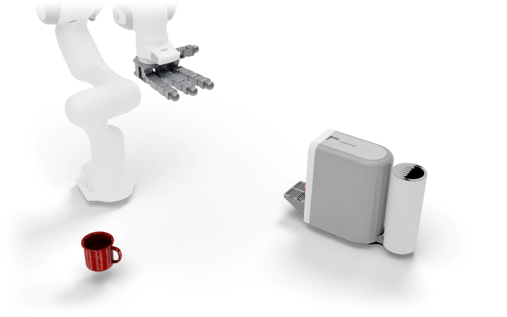

---
myst:
  html_meta:
    description: "Make Coffee: Put the mug on the tray of the espresso machine."
---

# Make Coffee

<span class="ds-chip blue">single arm</span><span class="ds-chip">rigid</span>

<p class="ds-lede">Put the mug on the tray of the espresso machine.</p>



## At a glance

<dl class="ds-spec">
<dt>Task key</dt><dd><code>make_coffee</code></dd>
<dt>Horizon</dt><dd>300 control steps (15 s at 20 Hz)</dd>
<dt>Objects</dt><dd>espresso machine, mug</dd>
<dt>Success</dt><dd>Mug within 6 cm of the tray target and turned by more than 1.1 rad from its start.</dd>
<dt>Failure</dt><dd>None.</dd>
<dt>Shown with</dt><dd>a Franka with the Allegro Hand</dd>
<dt>Action size</dt><dd>22 with the robot shown</dd>
<dt>Source</dt><dd><code>dexsuite/environments/single/rigid/make_coffee.py</code></dd>
</dl>

## Order of interactions

1. Grasp the mug
2. Carry it
3. Set it on the tray

These are the stages the [failure analysis](../data/benchmark.md#where-policies-fail) scores, in order.


## Observations

What the task adds under `obs["state"]["other"]`, next to the robot state and the last two actions. Shapes are for one environment; with `n_envs > 1` each gets a leading batch dimension.

| Key | Shape |
|---|---|
| `machine_pos` | (3,) |
| `machine_quat` | (4,) |
| `mug_pos` | (3,) |
| `mug_quat` | (4,) |
| `mug_target_pos` | (3,) |
| `mug_target_quat` | (4,) |

## Run it

```python
import dexsuite as ds

env = ds.make("make_coffee", manipulator="franka", gripper="allegro")
obs, info = env.reset(seed=0)
obs, reward, terminated, truncated, info = env.step(env.action_space.sample())
```
