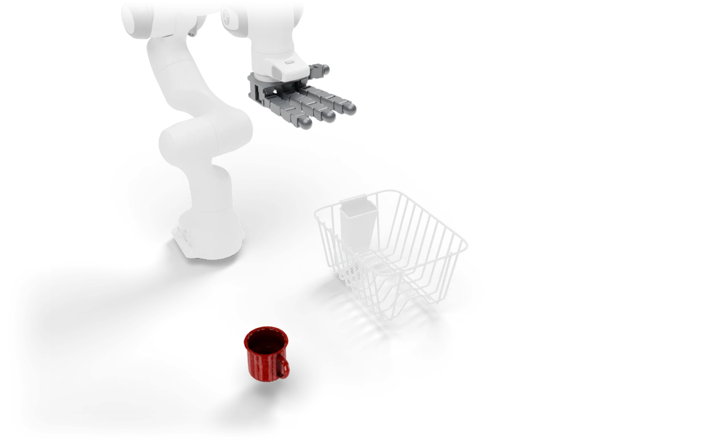

---
myst:
  html_meta:
    description: "Rack Mug: Pick up the mug, place it in the dish rack and let go."
---

# Rack Mug

<span class="ds-chip blue">Track 2 benchmark</span><span class="ds-chip">rigid</span><span class="ds-chip">dataset on Hugging Face</span>

<p class="ds-lede">Pick up the mug, place it in the dish rack and let go.</p>



<figure><video class="ds-video" src="../_static/clips/mug_allegro.mp4" poster="../_static/clips/mug_allegro.jpg" muted loop playsinline preload="none"></video><figcaption>A recorded demonstration from the dataset, replayed and rendered in Blender.</figcaption></figure>

## At a glance

<dl class="ds-spec">
<dt>Task key</dt><dd><code>pick_place_mug</code></dd>
<dt>Horizon</dt><dd>400 control steps (20 s at 20 Hz)</dd>
<dt>Objects</dt><dd>mug, dish rack</dd>
<dt>Success</dt><dd>Mug inside the rack footprint, at least 5 cm below the rack top, hand clear of the rack.</dd>
<dt>Failure</dt><dd>None.</dd>
<dt>Randomized at reset</dt><dd>Mug and rack each within ±12 cm on opposite sides of the table, yaw ±10°.</dd>
<dt>Shown with</dt><dd>a Franka with the Allegro Hand</dd>
<dt>Action size</dt><dd>22 with the robot shown</dd>
<dt>Source</dt><dd><code>dexsuite/environments/single/rigid/pick_place_mug.py</code></dd>
</dl>

## Order of interactions

1. Grasp the mug
2. Carry it into the rack
3. Release it

These are the stages the [failure analysis](../data/benchmark.md#where-policies-fail) scores, in order.


## Observations

What the task adds under `obs["state"]["other"]`, next to the robot state and the last two actions. Shapes are for one environment; with `n_envs > 1` each gets a leading batch dimension.

| Key | Shape |
|---|---|
| `mug_ang` | (3,) |
| `mug_pos` | (3,) |
| `mug_quat` | (4,) |
| `mug_vel` | (3,) |
| `rack_aabb_hi` | (3,) |
| `rack_aabb_lo` | (3,) |
| `rack_inner_hi` | (2,) |
| `rack_inner_lo` | (2,) |
| `rack_pos` | (3,) |
| `rack_quat` | (4,) |
| `rack_top_z` | (1,) |

## Run it

```python
import dexsuite as ds

env = ds.make("pick_place_mug", manipulator="franka", gripper="allegro")
obs, info = env.reset(seed=0)
obs, reward, terminated, truncated, info = env.step(env.action_space.sample())
```

## Baseline results

Success rate (%) from the DexSuite benchmark: mean ± standard deviation over three evaluation seeds with 50 episodes each. Bold is the best result within each input type. See [the benchmark](../data/benchmark.md) for the protocol.

| Baseline | Allegro hand |
|---|---|
| BC-G (state) | 25 ± 8 |
| BC-GMM (state) | 28 ± 2 |
| BC-T (state) | 58 ± 3 |
| Diffusion (state) | **82** ± 2 |
| ACT (image) | 37 ± 6 |
| Diffusion (image) | **56** ± 3 |
