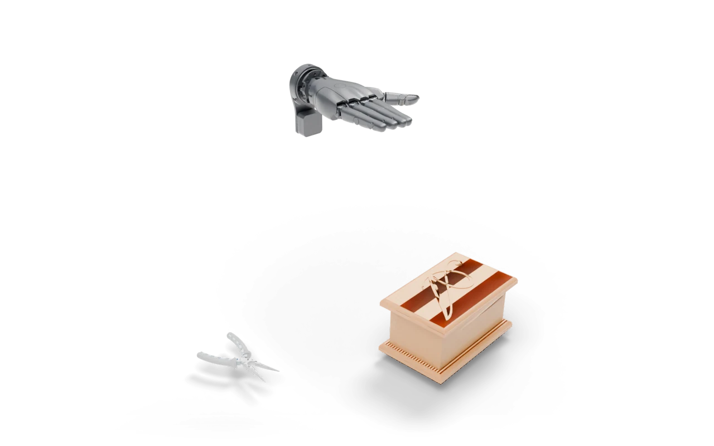

---
myst:
  html_meta:
    description: "Pliers in Jewelry Box: Open the lid of the jewelry box and lay the pliers inside."
---

# Pliers in Jewelry Box

<span class="ds-chip blue">single arm</span><span class="ds-chip">articulated</span>

<p class="ds-lede">Open the lid of the jewelry box and lay the pliers inside.</p>



## At a glance

<dl class="ds-spec">
<dt>Task key</dt><dd><code>pliers_in_jewelry_box</code></dd>
<dt>Horizon</dt><dd>600 control steps (30 s at 20 Hz)</dd>
<dt>Objects</dt><dd>jewelry box (hinged lid), pliers</dd>
<dt>Success</dt><dd>Pliers inside and flat, lid open at least 60°, at rest.</dd>
<dt>Failure</dt><dd>The pliers fall below the table.</dd>
<dt>Shown with</dt><dd>the Sharpa hand on a floating wrist</dd>
<dt>Action size</dt><dd>28 with the robot shown</dd>
<dt>Source</dt><dd><code>dexsuite/environments/single/rigid/pliers_in_jewelry_box.py</code></dd>
</dl>

## Order of interactions

1. Open the lid
2. Grasp the pliers
3. Lay them in the box

These are the stages the [failure analysis](../data/benchmark.md#where-policies-fail) scores, in order.


## Observations

What the task adds under `obs["state"]["other"]`, next to the robot state and the last two actions. Shapes are for one environment; with `n_envs > 1` each gets a leading batch dimension.

| Key | Shape |
|---|---|
| `box_pos` | (3,) |
| `box_quat` | (4,) |
| `lid_frac` | (1,) |
| `lid_q` | (1,) |
| `pliers_aabb_hi` | (3,) |
| `pliers_aabb_lo` | (3,) |
| `pliers_ang` | (3,) |
| `pliers_in_box_frame` | (3,) |
| `pliers_inside` | (1,) |
| `pliers_pos` | (3,) |
| `pliers_quat` | (4,) |
| `pliers_vel` | (3,) |

## Run it

```python
import dexsuite as ds

env = ds.make("pliers_in_jewelry_box", manipulator="floating", gripper="sharpa")
obs, info = env.reset(seed=0)
obs, reward, terminated, truncated, info = env.step(env.action_space.sample())
```

```{important}
Not in the pip package yet. This task runs from the `fudi` branch of the repository:
`git clone -b fudi https://github.com/anashoussaini/Dexsuite.git`, then `pip install -e .` in the clone.
```
