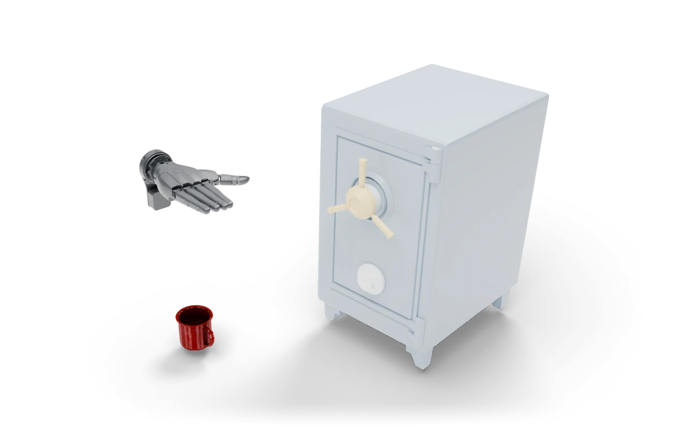

---
myst:
  html_meta:
    description: "Stow in Safe: Unbolt and open the safe, put the mug inside and close the door."
---

# Stow in Safe

<span class="ds-chip blue">single arm</span><span class="ds-chip">articulated</span>

<p class="ds-lede">Unbolt and open the safe, put the mug inside and close the door.</p>



## At a glance

<dl class="ds-spec">
<dt>Task key</dt><dd><code>stow_in_safe</code></dd>
<dt>Horizon</dt><dd>1,200 control steps (60 s at 20 Hz)</dd>
<dt>Objects</dt><dd>safe, mug</dd>
<dt>Success</dt><dd>Unlocked, mug inside and at rest, door within 5° of closed.</dd>
<dt>Failure</dt><dd>The mug falls below the table.</dd>
<dt>Shown with</dt><dd>the Sharpa hand on a floating wrist</dd>
<dt>Action size</dt><dd>28 with the robot shown</dd>
<dt>Source</dt><dd><code>dexsuite/environments/single/rigid/stow_in_safe.py</code></dd>
</dl>

## Order of interactions

1. Turn the handle
2. Open the door
3. Place the mug inside
4. Close the door

These are the stages the [failure analysis](../data/benchmark.md#where-policies-fail) scores, in order.


## Observations

What the task adds under `obs["state"]["other"]`, next to the robot state and the last two actions. Shapes are for one environment; with `n_envs > 1` each gets a leading batch dimension.

| Key | Shape |
|---|---|
| `dial_q` | (1,) |
| `door_edge_pos` | (3,) |
| `door_frac` | (1,) |
| `door_pos` | (3,) |
| `door_q` | (1,) |
| `door_quat` | (4,) |
| `handle_pos` | (3,) |
| `handle_q` | (1,) |
| `handle_turn` | (1,) |
| `mug_aabb_hi` | (3,) |
| `mug_aabb_lo` | (3,) |
| `mug_in_safe_frame` | (3,) |
| `mug_inside` | (1,) |
| `mug_pos` | (3,) |
| `mug_quat` | (4,) |
| `mug_vel` | (3,) |
| `safe_pos` | (3,) |
| `safe_quat` | (4,) |
| `unlocked` | (1,) |

## Run it

```python
import dexsuite as ds

env = ds.make("stow_in_safe", manipulator="floating", gripper="sharpa")
obs, info = env.reset(seed=0)
obs, reward, terminated, truncated, info = env.step(env.action_space.sample())
```

```{important}
Not in the pip package yet. This task runs from the `fudi` branch of the repository:
`git clone -b fudi https://github.com/anashoussaini/Dexsuite.git`, then `pip install -e .` in the clone.
```

```{note}
Runs with n_envs=1.
```
